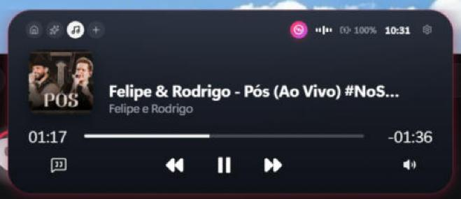
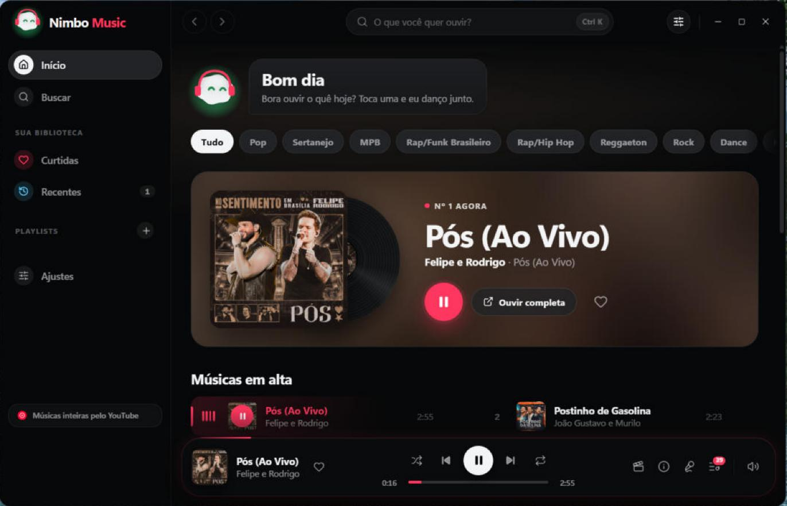
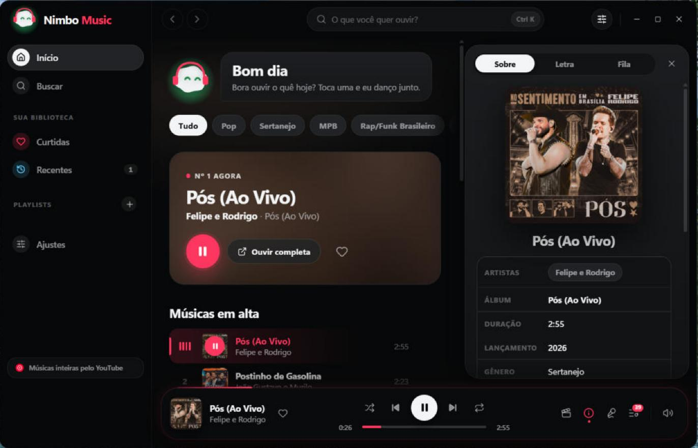
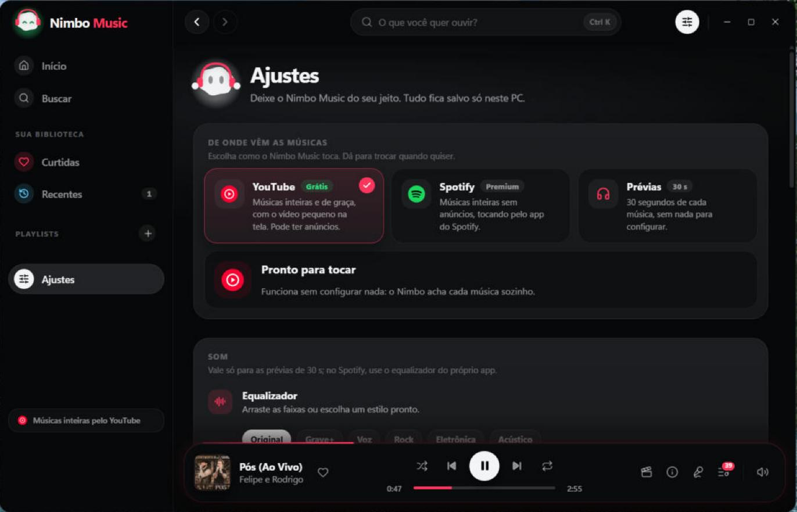

<div align="center">


# Nimbo

**A ilha do seu Windows.**
Música, tarefas, foco, agenda, casa inteligente e agentes de IA numa ilha flutuante no topo da tela.
Grátis e de código aberto.

[](#baixar)
[](https://tauri.app)
[](https://react.dev)
[](https://www.rust-lang.org)
[](https://www.typescriptlang.org)
[](LICENSE)
[](https://github.com/EduardoxDev/Nimbo/releases/latest)

[Baixar](#baixar) · [O que ele faz](#o-que-ele-faz) · [Nimbo Music](#nimbo-music) · [Rodar o código](#rodar-o-código) · [Créditos](#créditos)

<br />



</div>

<br />

## Por que o Nimbo

A Dynamic Island do iPhone mostra o que importa sem atrapalhar. O Nimbo leva essa ideia para o
Windows: uma ilha discreta no topo da tela que **abre quando você passa o mouse** e mostra a música,
o foco, a próxima reunião ou o que o seu agente de IA está fazendo. Fechada, ela vira um fio com o
mascote, um anel de progresso e os avisos que chegam.

Ele é leve (Tauri + Rust, nada de Electron), fala português, inglês e chinês, e **guarda tudo no seu
PC**: senhas e chaves ficam no Gerenciador de Credenciais do Windows.

## O que ele faz

<table>
<tr>
<td width="50%" valign="top">

### 🎵 Música
- Controla **qualquer player do Windows** (Spotify, YouTube, apps de música): capa, tempo, volume.
- **Letras sincronizadas** pelo [LRCLIB](https://lrclib.net).
- **Nimbo Music**: um app de música completo, [mais abaixo](#nimbo-music).

### ✅ Produtividade
- **Tarefas do dia**, nota diária e histórico.
- **Foco (Pomodoro)** com anel de progresso, rodadas e som no fim.
- **Água**: meta do dia, copo que enche e lembretes.
- **Agenda** do Google ou Outlook com aviso antes de cada compromisso e **modo reunião**.
- **Lançador** (Alt+Shift+Espaço) que acha apps, arquivos (“aquele PDF do contrato de março”),
  copiados e tarefas, e entende lembretes, rotinas e regras em português.
- **Meu dia**: linha do tempo do que você fez, raio-X do tempo por app, diário automático e
  plano do dia montado com suas tarefas e a agenda.
- **Rotinas de um clique**: “bom dia” abre seus apps, liga o ar e lê o resumo do dia.
- **“Onde eu parei?”**: salva os apps e arquivos de um projeto e reabre tudo depois.
- **Histórico de copiados** com favoritos e notas, que nunca guarda senhas, chaves, CPF ou cartão.
- **Ações ao copiar**: link, telefone, endereço, rastreio, conta, erro ou PDF viram um botão.
- **Prateleira**: arraste arquivos para a ilha e pegue de volta depois.

</td>
<td width="50%" valign="top">

### 🤖 IA
- **Assistente na ilha**: “liga o ar em 22 e começa um foco”. Escolha a IA: **Ollama** (no seu PC,
  sem conta), **Gemini** ou **Groq**, todas grátis, ou o Claude.
- **“Ei Nimbo”**: peça por voz.
- **Agentes de IA** (Claude Code, Cursor, Codex…) mostram o plano na ilha, pedem aprovação e avisam
  quando terminam, por um servidor MCP local.
- **Tradução rápida** em português, inglês, espanhol e chinês.
- **A ilha lê a tela** (Alt+Shift+L): arraste em volta de qualquer coisa para copiar o texto, a
  tabela (cola no Excel) ou a imagem, traduzir, explicar ou resumir. A leitura é offline.
- **Resuma qualquer coisa**: link, vídeo do YouTube (pela legenda), PDF ou texto.
- **Pergunte ao seu PC**: “por que está lento?”, “libera espaço”, “desliga em 1 hora”.

### 🏠 Casa e sistema
- **Ar-condicionado, luzes, tomadas** pelo [Home Assistant](https://www.home-assistant.io/), com
  automações por horário.
- **Ar só de controle remoto** com um Broadlink RM4 Mini, sem nuvem.
- **Sistema**: bateria, CPU, memória, Wi‑Fi, Bluetooth, modo escuro e volume por app.
- **HUD na ilha**: volume e brilho no lugar dos pop-ups do Windows.
- **Tempo** da sua cidade no topo da ilha.
- **Regras**: “quando conectar o fone, toca minha playlist”, “quando a bateria chegar a 20%, me
  avisa”, “quando eu chegar em casa, liga o ar em 23”.
- **Ensine uma vez**: grave cliques e teclas de uma tarefa e repita com “faz relatório semanal”.
- **Downloads arrumado** em pastas por tipo, com desfazer, e aviso de arquivos grandes esquecidos.
- **Modo reunião** quando o microfone entra numa chamada, **Não Perturbe** no foco e em tela
  cheia, e aviso quando um app liga a câmera ou o microfone.

### 📱 Celular
- **Ilha no celular** pelo Wi-Fi de casa, com QR code: música, foco, avisos, bloquear o PC e
  mandar textos e fotos entre o celular e o PC.
- **Notificações do celular na ilha** pelo Vincular ao Celular do Windows.
- **Nimbo no iPhone, de graça**: a mesma ilha como web app (qualquer pessoa adiciona à Tela
  de Início, com avisos) ou o app completo com **widgets** e **ilha dinâmica** pelo SideStore,
  com controle do PC **de qualquer lugar** pelo seu servidor grátis no Cloudflare. Guia em
  [mobile/README.md](mobile/README.md).

</td>
</tr>
</table>

E ainda: **mascote** que reage ao que acontece (dorme à noite, comemora metas, fica tonto de tanto
clique), temas, atalhos globais configuráveis, ilha clássica ou de vidro e atualização automática.

## Nimbo Music

Um app de música inteiro dentro do Nimbo: **todas as músicas, inteiras e de graça**, sem conta e
sem configurar nada. Abre pelo disco colorido na página Música da ilha ou pela bandeja.

<p align="center">
  
</p>

<table>
<tr>
<td width="50%"></td>
<td width="50%"></td>
</tr>
<tr>
<td align="center"><sub>Créditos e links de cada música</sub></td>
<td align="center"><sub>Você escolhe de onde vem a música</sub></td>
</tr>
</table>

- **Catálogo completo** da [Deezer](https://developers.deezer.com/api): em alta por gênero, busca de
  músicas, artistas e álbuns, discografia e artistas parecidos.
- **Músicas inteiras pelo YouTube** (tocador oficial, sem precisar de chave), ou pelo **Spotify
  Premium**, ou prévias de 30 s. O Nimbo acha a versão certa (estúdio ou ao vivo) e deixa trocar.
- **Só o som por padrão**, com o **videoclipe** ao lado quando você quiser: pequeno, grande ou em
  modo cinema.
- **Sobre a música**: artistas, álbum, lançamento, gênero, gravadora e links do YouTube e do Spotify.
- **Letra sincronizada**, **fila** com arrastar para reordenar, **playlists** com capa em mosaico,
  curtidas e recentes.
- **Rádio do Nimbo**, timer para dormir, equalizador, filtro de conteúdo explícito e cor de destaque.
- **O mascote dança** com a música, de fones de ouvido.
- **“Ei Nimbo, toca Anitta”** funciona até sem a chave da Anthropic.

> As músicas pertencem aos artistas e gravadoras. O Nimbo toca pelo tocador oficial do YouTube ou
> pelo app do Spotify, mostra os créditos de cada faixa e **não baixa áudio**.

## Baixar

Pegue o instalador `Nimbo_<versão>_x64-setup.exe` na
**[página de versões](https://github.com/EduardoxDev/Nimbo/releases/latest)**. Ele instala só para o
seu usuário, sem pedir administrador, e se atualiza sozinho.

O instalador ainda não é assinado, então o Windows mostra o aviso do SmartScreen na primeira vez:
clique em **Mais informações** e depois em **Executar assim mesmo**.

## Rodar o código

Precisa de **Node 20+** e **Rust** (stable).

```powershell
npm install
npm run tauri dev       # o app de verdade, com recarga ao vivo
npm run dev             # só a interface, no navegador
npm test                # testes
```

Gerar o executável sem instalador:

```powershell
npm run tauri build -- --no-bundle
```

Abrir direto no Nimbo Music (bom para atalhos): `nimbo.exe --music`.

<details>
<summary><b>Onde está cada coisa</b></summary>

| Pasta ou arquivo | O que tem |
|---|---|
| `src/App.tsx` | A ilha: estado, páginas e quase toda a interface |
| `src/music/` | Nimbo Music (janela, tocadores do YouTube, Spotify e prévias, playlists) |
| `src/mascot/` | O mascote: forma, olhos, humores e acessórios |
| `src/i18n/` | Textos em português, inglês e chinês |
| `src-tauri/src/lib.rs` | Janela, bandeja, comandos e inicialização com o Windows |
| `src-tauri/src/media_control.rs` | Música do Windows (SMTC) |
| `src-tauri/src/music_catalog.rs`, `youtube.rs`, `spotify.rs` | Catálogo, busca de vídeos e Spotify |
| `src-tauri/src/agents.rs` | Servidor MCP para agentes de IA |
| `mobile/` | App do iPhone (Expo), widgets e ilha dinâmica em Swift |
| `relay/` | Servidor no Cloudflare que liga o iPhone ao PC de qualquer lugar |

Guia para quem mexe no código: [AGENTS.md](AGENTS.md). Plano e próximos passos: [PLANO.md](PLANO.md).

</details>

<details>
<summary><b>Publicar uma versão</b></summary>

O Nimbo procura versão nova 30 segundos depois de abrir e a cada 6 horas, em
`https://github.com/EduardoxDev/Nimbo/releases/latest/download/latest.json`, e confere cada
atualização com a chave pública que está em `src-tauri/tauri.conf.json`.

1. No GitHub, em Settings → Secrets and variables → Actions, crie o segredo
   `TAURI_SIGNING_PRIVATE_KEY` com o conteúdo da chave privada (só na primeira vez).
2. Suba a versão em `package.json`, `src-tauri/tauri.conf.json` e `src-tauri/Cargo.toml`.
3. Faça o commit, crie a tag e envie:

```powershell
git tag v0.5.0
git push origin main --tags
```

O fluxo `Release` do GitHub Actions gera o instalador, assina e publica a versão com o
`latest.json`. Quem já tem o Nimbo recebe a atualização sozinho.

Para gerar o instalador no seu PC, a chave privada (em `~/.tauri/nimbo-updater.key`, fora do Git)
precisa estar no ambiente. **Guarde uma cópia dela**: sem ela não dá para publicar atualizações.

```powershell
$env:TAURI_SIGNING_PRIVATE_KEY = Get-Content -Raw "$HOME\.tauri\nimbo-updater.key"
$env:TAURI_SIGNING_PRIVATE_KEY_PASSWORD = ""
npm run tauri build
```

</details>

## Privacidade

- Chaves e tokens (IA, Home Assistant, agenda, Spotify) ficam só no **Gerenciador de
  Credenciais do Windows**. Com o Ollama, a IA roda no seu PC e nada sai dele.
- O registro do **Meu dia** (qual app estava na frente) fica só no PC, some depois de 30 dias,
  pode ser pausado ou apagado, e não guarda títulos de janelas anônimas nem de gerenciadores de senha.
- A **ilha no celular** vem desligada; quando ligada, só responde na sua rede e com o código do QR.
- Leitura da tela, ações gravadas e Downloads arrumado acontecem no PC, sem enviar nada.
- Tarefas, curtidas, playlists e ajustes ficam **no seu PC**.
- O que sai do PC é só o necessário para cada recurso: o nome da música para achar a letra ou o
  vídeo, a cidade para o tempo, e o que você escreve para o assistente quando conversa com ele.

## Créditos

- Começou como um fork do [fly-island](https://github.com/flyl1u/fly-island) (MIT), de flyl1u e
  colaboradores. As integrações de QQ, WeChat e QQ Mail foram removidas.
- Códigos infravermelhos de ar-condicionado: [SmartIR](https://github.com/smartHomeHub/SmartIR) (MIT),
  baixados só quando você escolhe o seu modelo.
- Catálogo e prévias: [Deezer](https://developers.deezer.com/api). Letras: [LRCLIB](https://lrclib.net).
  Tempo: [Open-Meteo](https://open-meteo.com).
- Arrastar arquivos para fora: [tauri-plugin-drag](https://github.com/crabnebula-dev/drag-rs) (MIT/Apache-2.0).
- QR code da ilha no celular: [qrcode](https://github.com/kennytm/qrcode-rust) (MIT/Apache-2.0).

<div align="center">
<br />
<sub>Feito por <a href="https://github.com/EduardoxDev">Eduardo Maciel Wanka</a> · Licença <a href="LICENSE">MIT</a></sub>
</div>
