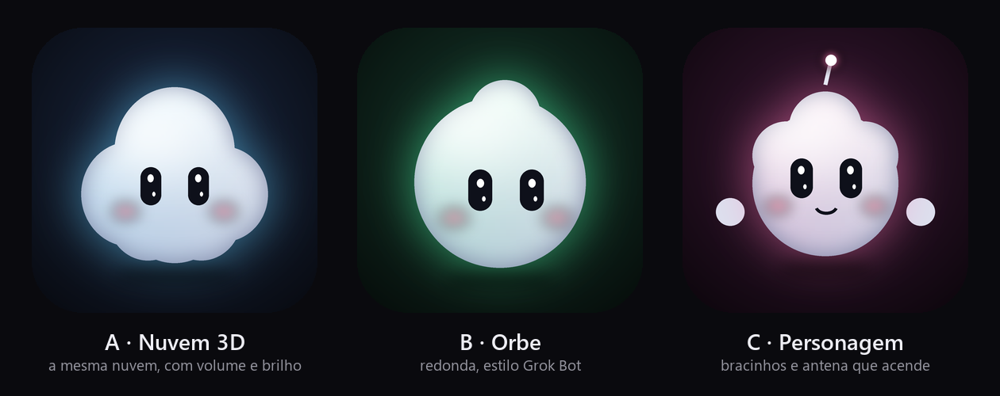
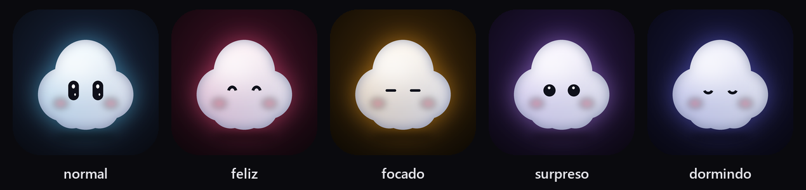

# Nimbo 2.0 — planejamento

> Data: 02/11/2026. Objetivo: o Nimbo ficar **mais bonito, mais vivo e mais útil que o Grok Bot**,
> no PC e no iPhone, com um mascote que as pessoas queiram mostrar.

---

## 1. Onde estamos (sincero)

| Área | Hoje | Problema |
|---|---|---|
| Mascote | Nuvem branca chapada com dois ovais pretos | Sem volume, sem luz, pouca expressão. Parece ícone, não personagem. |
| Ilha | Funciona bem, muitas páginas | Cada página tem um estilo; transições secas; muita coisa ao mesmo tempo. |
| Configurações | 18 páginas | Difícil achar as coisas; não tem busca. |
| iPhone | Web app + app completo (SideStore) | Visual simples; login do SideStore travado; sem App Store. |
| Recursos | Muitos (IA, música, foco, regras, celular…) | Escondidos: a pessoa não descobre o que o Nimbo faz. |

**O que o Grok Bot faz melhor:** mascote com volume e brilho (parece um objeto de verdade), poucos
elementos por tela, cartões de agentes bem organizados, widget que é *só* o personagem.

**O que já fazemos melhor:** muito mais recursos, tudo local e de graça, controle do PC de qualquer
lugar, regras, rotinas, música inteira, leitura de tela.

---

## 2. Mascote 2.0

### 2.1 Escolher a forma

| | A · Nuvem 3D | B · Orbe | C · Personagem |
|---|---|---|---|
| Ideia | A nuvem de hoje com volume, brilho e bochechas | Bola com um topete de nuvem, estilo Grok Bot | Nuvem gordinha com bracinhos e antena que acende |
| Prós | Mantém a identidade; ninguém estranha | Mais "premium", lê bem em tamanho pequeno | Mais expressivo (acena, aponta, comemora) |
| Contras | Silhueta mais complexa em 16 px | Fica parecido demais com o Grok | Mais trabalho para animar |

**Recomendação:** **A como base** (é a nossa identidade) **com os bracinhos e a antena de C** só nos
momentos especiais (comemorar uma meta, avisar algo). Em tamanho pequeno (ilha fechada) só o rosto.

### 2.2 Humores

Cada humor tem **cor de brilho própria** (a mesma cor do assunto: rosa música, laranja foco,
roxo IA, azul normal, índigo dormindo) e **olhos diferentes**:

| Humor | Quando | Olhos | Movimento |
|---|---|---|---|
| Normal | Nada acontecendo | Abertos com dois brilhos | Respira devagar, pisca a cada 3–6 s |
| Feliz | Música, meta batida | ^ ^ | Balança no ritmo da batida |
| Focado | Pomodoro | — — | Parado, quase sem respirar |
| Pensando | IA respondendo | Olham para cima e para o lado | Gira uma "nuvenzinha" de reticências |
| Surpreso | Aviso novo | Bolinhas grandes | Pulinho com squash & stretch |
| Preocupado | Erro, bateria fraca | Sobrancelha caída | Treme leve |
| Dormindo | Noite, PC parado | Fechados | Sobe e desce + "z" |

### 2.3 O que faz parecer vivo (detalhes que o Grok tem e vamos superar)

1. **Volume:** gradiente de cima para baixo, sombra interna na borda, reflexo branco suave no
   alto, bochechas rosadas, sombra no chão.
2. **Olhos com vida:** dois pontos de brilho, **seguem o mouse**, piscam com tempo aleatório,
   às vezes olham para o lado sozinhos.
3. **Física:** *squash & stretch* ao pular, molas (spring) em vez de animação linear, leve
   atraso nas "bolinhas" da nuvem (parece macio).
4. **Reações:** clicou → ri; clicou muito → fica tonto; arrastou arquivo → abre a boca;
   passou o mouse rápido → assusta.
5. **Brilho que conta algo:** a cor da aura é o estado (sem precisar ler).
6. **Igual em todo lugar:** o mesmo desenho no PC, no app do iPhone, no widget e na ilha do iPhone.

### 2.4 Como fazer (técnica)

- Desenho em **SVG em camadas** (corpo, sombra, reflexo, bochechas, olhos, extras), com gradientes;
  o motor de hoje (`src/mascot/engine.ts`) já calcula a forma e o humor: trocamos o "pintor".
- Animações com **molas** num único loop (`requestAnimationFrame`), pausando quando a ilha está
  escondida (economia de CPU).
- Exportar o mesmo desenho para o Swift do iPhone (já começamos em `targets/widget/Shared.swift`).
- Opcional depois: animações especiais em **Rive** (runtime MIT) para comemorações.

**Entrega:** `src/mascot` novo + página de prévia com todos os humores + testes de desempenho
(menos de 1% de CPU parado).

---

## 3. UI e UX: melhor que o Grok Bot

### 3.1 Sistema de design (a base de tudo)

- **Tokens únicos** para PC, iPhone e web: cores, raios, espaçamento (4/8/12/16/24), sombras,
  vidro, tipografia (Segoe UI Variable no PC, SF no iPhone).
- **Cores por assunto** (já usamos, vamos padronizar): música `#ff375f`, foco `#ff9f0a`,
  tarefas `#35e985`, água `#5ac8fa`, IA `#bf8cff`, casa `#40c8e0`, aviso `#ffd60a`.
- **Componentes iguais em todo lugar:** cartão, chip de agente, botão, alternador, lista, campo,
  barra de progresso, anel.
- **Movimento:** tudo em mola (entrada 300–450 ms), a ilha "derrete" de um tamanho para outro
  como a Dynamic Island (morph), nunca pisca do nada.

### 3.2 A ilha

| Hoje | Depois |
|---|---|
| Abre já cheia de coisas | **3 tamanhos**: fechada (rosto + 1 info), compacta (o mais importante agora), aberta (tudo) |
| Páginas com estilos diferentes | Todas com o mesmo cabeçalho, cartões e espaçamento |
| Avisos competem com a música | **Prioridade**: aviso urgente > agente pedindo aprovação > foco > música > relógio |
| Agentes em lista | **Chips de agentes** como no Grok (ícone colorido + o que está fazendo), clicáveis |
| Transição seca | Morph com mola + o mascote "anda" até o assunto novo |

### 3.3 Descoberta (as pessoas não sabem o que o Nimbo faz)

- **Onboarding de 60 segundos** com o mascote apresentando 5 coisas e pedindo as permissões na
  hora certa (não tudo de uma vez).
- **Dicas no contexto:** copiou um link pela 1ª vez → "Sabia que dá para resumir?".
- **Busca nas Configurações** (Ctrl+F) e "o que eu quero fazer?" em linguagem natural.
- **Configurações em 6 grupos** (Ilha, Mascote, Produtividade, IA, Casa, Celular) em vez de 18 páginas.

### 3.4 Qualidade

- 60 fps nas animações, menos de 1% de CPU parado, ilha abre em menos de 100 ms.
- Acessibilidade: teclado em tudo, contraste AA, "reduzir movimento" respeitado, leitor de tela.
- Modo claro de verdade (hoje é só escuro).
- Sons opcionais e discretos (abrir, concluir, aviso), desligados por padrão.

### 3.5 iPhone

- App com o **mesmo visual da ilha** e o mascote 2.0 grande na tela inicial.
- **Widgets:** mascote (como o Grok Bot), mascote + música, mascote + foco, tela de bloqueio.
- **Ilha do iPhone:** mascote com o humor + 1 informação + botões.
- Haptics (vibração leve) em cada toque importante.

---

## 4. Ideias novas que fazem diferença

Filtro usado: resolve um problema real, é visível, e dá para fazer bem dentro do Nimbo.

### 4.1 PC + iPhone juntos (nosso grande diferencial)

1. **Continuar no celular:** saiu do PC? O iPhone mostra "você estava em…" com a música, a aba, o
   arquivo e a tarefa, e continua de onde parou.
2. **Área de transferência compartilhada:** copiou no PC, cola no iPhone, e vice-versa (pelo
   servidor, com código da sala).
3. **Aprovar agentes de IA pelo celular:** o Claude Code pede permissão → notificação no iPhone →
   aprovar ou negar de qualquer lugar.
4. **"Achei meu PC":** do iPhone, ver se o PC está ligado, a bateria, o que está rodando, e
   desligar, bloquear ou tocar um som.
5. **Foco sincronizado:** começou o foco no PC → iPhone entra em Foco (Atalhos do iOS) e vice-versa.

### 4.2 IA que trabalha por você

6. **Copiloto de reunião (local):** transcreve a chamada no PC, no fim entrega resumo, decisões e
   tarefas já criadas na ilha.
7. **Resumo do dia com voz do Nimbo:** de manhã, agenda + tarefas + e-mails importantes + tempo, em
   30 segundos, e à noite o que foi feito.
8. **Memória pessoal:** "onde eu salvei aquele contrato?", "o que o João me mandou ontem?",
   buscando na linha do tempo, nos copiados e nos arquivos, tudo local.
9. **Agente do Nimbo:** pedir "organiza minha pasta do TCC e me manda um resumo" e acompanhar os
   passos na ilha, aprovando o que for sensível.
10. **Legenda e tradução ao vivo** de vídeos e chamadas, numa faixa embaixo da ilha.

### 4.3 Produtividade sem esforço

11. **Layouts de janelas por projeto:** "modo programar" abre VS Code à esquerda, navegador à
    direita, música tocando e foco ligado.
12. **Bloqueio de distrações no foco** (sites e apps escolhidos), com a ilha avisando com carinho.
13. **Ler depois inteligente:** salvar links do PC ou do iPhone; o Nimbo resume e lembra na hora livre.
14. **Caixa de entrada única na ilha:** WhatsApp, e-mail e Teams num só lugar, com resposta rápida.
15. **Lembretes por lugar (iPhone):** "quando eu chegar na faculdade, me lembra de…".

### 4.4 Plataforma

16. **Plugins:** página na ilha feita por qualquer pessoa (cotação, placar, status de servidor),
    com loja simples.
17. **Sincronizar configurações** entre PCs pelo servidor.
18. **Ilha em vários monitores** e na barra de tarefas.
19. **App na App Store/TestFlight** quando houver a conta da Apple (ilha atualizando com o app fechado).
20. **Site do Nimbo** com download, prints e o mascote animado (portfólio).

---

## 5. Roteiro

| Fase | Duração | Entrega | Por que primeiro |
|---|---|---|---|
| **1. Mascote 2.0** | 1–2 semanas | Novo desenho, 7 humores, olhos que seguem o mouse, física, igual no PC e no iPhone | É o rosto do produto; muda a impressão na hora |
| **2. Sistema de design** | 1 semana | Tokens, componentes, molas, modo claro | Base para refazer as telas sem retrabalho |
| **3. Ilha 2.0** | 2 semanas | 3 tamanhos, prioridade de avisos, chips de agentes, morph | O que a pessoa vê o dia inteiro |
| **4. Descoberta** | 1 semana | Onboarding com o mascote, dicas, busca e 6 grupos nas Configurações | Faz as pessoas usarem o que já existe |
| **5. iPhone 2.0** | 2 semanas | App com o visual novo, widgets novos, haptics; resolver SideStore | Diferencial PC + iPhone |
| **6. PC + iPhone** | 2–3 semanas | Ideias 1 a 5 (continuar, área de transferência, aprovar agentes, achei meu PC, foco) | Ninguém faz isso tão bem |
| **7. IA** | 3–4 semanas | Ideias 6 a 10 | Maior valor, mais trabalho |
| **8. Plataforma** | contínuo | Plugins, sync, multi-monitor, site | Crescimento |

**Como medir:** CPU parada < 1%, ilha abre < 100 ms, 0 erros no registro por semana,
pessoas usando ao menos 3 recursos na primeira semana (contado só no PC, sem enviar nada).

---

## 6. Riscos

- **Mascote "fofo demais" ou parecido com o Grok:** manter a silhueta de nuvem (opção A) e as cores
  por assunto, que são nossas.
- **Animação pesando o PC:** um só loop, pausa quando escondido, teste de CPU em cada versão.
- **iPhone sem conta paga:** web app e SideStore funcionam; App Store fica para quando houver a conta.
- **Muita coisa ao mesmo tempo:** seguir as fases em ordem; cada fase termina com versão publicada.
